<!--
Profile README for github.com/hafisfox, styled after hafisfox.io.
Generated by scripts/build.mjs, which also draws every SVG in assets/. Edit the script, not this file.
-->

<a href="https://hafisfox.io"><picture><source media="(prefers-color-scheme: dark)" srcset="assets/hero-dark.svg" /><source media="(prefers-color-scheme: light)" srcset="assets/hero-light.svg" /></picture></a>

  <a href="https://hafisfox.io"><picture><source media="(prefers-color-scheme: dark)" srcset="assets/pill-site-dark.svg" /><source media="(prefers-color-scheme: light)" srcset="assets/pill-site-light.svg" /></picture></a>
  <a href="https://hafisfox.io/services"><picture><source media="(prefers-color-scheme: dark)" srcset="assets/pill-services-dark.svg" /><source media="(prefers-color-scheme: light)" srcset="assets/pill-services-light.svg" /></picture></a>
  <a href="https://hafisfox.io/work"><picture><source media="(prefers-color-scheme: dark)" srcset="assets/pill-work-dark.svg" /><source media="(prefers-color-scheme: light)" srcset="assets/pill-work-light.svg" /></picture></a>
  <a href="https://hafisfox.io/pricing"><picture><source media="(prefers-color-scheme: dark)" srcset="assets/pill-pricing-dark.svg" /><source media="(prefers-color-scheme: light)" srcset="assets/pill-pricing-light.svg" /></picture></a>
  <a href="https://hafisfox.io/about"><picture><source media="(prefers-color-scheme: dark)" srcset="assets/pill-about-dark.svg" /><source media="(prefers-color-scheme: light)" srcset="assets/pill-about-light.svg" /></picture></a>
  <a href="https://www.linkedin.com/in/hafisjavad"><picture><source media="(prefers-color-scheme: dark)" srcset="assets/pill-linkedin-dark.svg" /><source media="(prefers-color-scheme: light)" srcset="assets/pill-linkedin-light.svg" /></picture></a>
  <a href="mailto:hafisjavad@gmail.com"><picture><source media="(prefers-color-scheme: dark)" srcset="assets/pill-email-dark.svg" /><source media="(prefers-color-scheme: light)" srcset="assets/pill-email-light.svg" /></picture></a>

<a href="https://hafisfox.io/about"><picture><source media="(prefers-color-scheme: dark)" srcset="assets/intro-dark.svg" /><source media="(prefers-color-scheme: light)" srcset="assets/intro-light.svg" /></picture></a>

 

  <a href="https://hafisfox.io/services#ai-agents"><picture><source media="(prefers-color-scheme: dark)" srcset="assets/cap-agents-dark.svg" /><source media="(prefers-color-scheme: light)" srcset="assets/cap-agents-light.svg" /></picture></a>
  <a href="https://hafisfox.io/services#automation"><picture><source media="(prefers-color-scheme: dark)" srcset="assets/cap-automation-dark.svg" /><source media="(prefers-color-scheme: light)" srcset="assets/cap-automation-light.svg" /></picture></a>

  <a href="https://hafisfox.io/services#operations"><picture><source media="(prefers-color-scheme: dark)" srcset="assets/cap-operations-dark.svg" /><source media="(prefers-color-scheme: light)" srcset="assets/cap-operations-light.svg" /></picture></a>
  <a href="https://hafisfox.io/services#product"><picture><source media="(prefers-color-scheme: dark)" srcset="assets/cap-product-dark.svg" /><source media="(prefers-color-scheme: light)" srcset="assets/cap-product-light.svg" /></picture></a>

  <a href="https://hafisfox.io/services#integrations"><picture><source media="(prefers-color-scheme: dark)" srcset="assets/cap-integrations-dark.svg" /><source media="(prefers-color-scheme: light)" srcset="assets/cap-integrations-light.svg" /></picture></a>
  <a href="https://hafisfox.io/services#dashboards"><picture><source media="(prefers-color-scheme: dark)" srcset="assets/cap-dashboards-dark.svg" /><source media="(prefers-color-scheme: light)" srcset="assets/cap-dashboards-light.svg" /></picture></a>

<picture><source media="(prefers-color-scheme: dark)" srcset="assets/process-dark.svg" /><source media="(prefers-color-scheme: light)" srcset="assets/process-light.svg" /></picture>

<picture><source media="(prefers-color-scheme: dark)" srcset="assets/toolbox-dark.svg" /><source media="(prefers-color-scheme: light)" srcset="assets/toolbox-light.svg" /></picture>

<a href="https://hafisfox.io/pricing"><picture><source media="(prefers-color-scheme: dark)" srcset="assets/cta-dark.svg" /><source media="(prefers-color-scheme: light)" srcset="assets/cta-light.svg" /></picture></a>

Applied AI and automation, built by the person you actually talk to · <a href="https://hafisfox.io">hafisfox.io</a>

